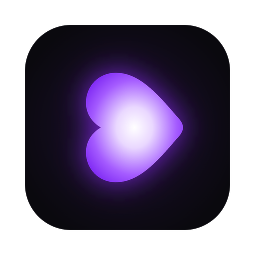
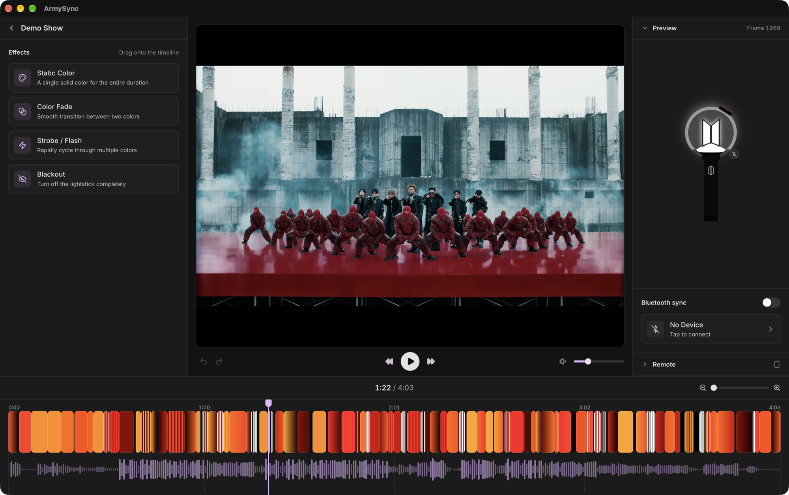
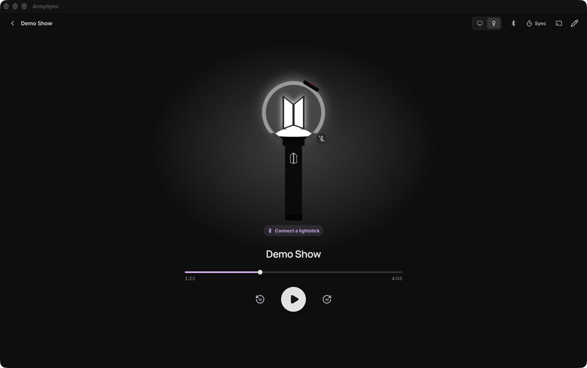

<p align="center">
  
</p>

<h1 align="center">ArmySync</h1>

<p align="center">
  Desktop app to program BTS Army Bomb light shows and play them in sync with your videos.
</p>

---

<p align="center">
  
</p>

## Features

- **Library** — Songs from a local video or audio file, a YouTube link, or your Jellyfin server (streamed, never downloaded), grouped into playlists
- **Timeline Editor** — Drag-and-drop effects over the video and its waveform, with undo/redo, copy/paste and multi-select
- **4 Effect Types** — Static Color, Color Fade, Strobe/Flash (BPM-based with tap sync) and Blackout
- **Player** — Watch a show full screen, or switch to Lights only for a music-player view; fine-tune the sync offset on the fly
- **Follow your TV** — Play a show on a Jellyfin device (Android TV, web) and the lights follow it: play, pause, seek and video changes. Start it from the Mac or from the TV
- **Phone Remote** — Record effects live from your phone by holding color pads, scrub the timeline, start with a 3 s sync countdown and calibrate latency
- **Bluetooth Lightsticks** — Connect real Army Bombs (V4, V3, SE, Multi) with per-device latency compensation; the preview shows the sticks you have connected

<p align="center">
  
</p>

## How to Use

1. **Add a song** — In the library, click "New Project" and pick a file, a YouTube URL or a Jellyfin video
2. **Program the lights** — Drag effects onto the timeline, or record them live from the phone remote
3. **Connect your Army Bombs** — Open Devices, scan and connect; adjust each device's delay if it lags
4. **Play** — Hit Play in the library to open the Player, or use Cast in the Player to follow a Jellyfin device

## Keyboard Shortcuts

**Editor**

| Key | Action |
|-----|--------|
| `Space` | Play / Pause |
| `←` / `→` (`Shift` for larger step) | Seek |
| `↑` / `↓` | Volume |
| `Cmd+Z` / `Cmd+Shift+Z` | Undo / Redo |
| `Cmd+C` / `Cmd+V` / `Cmd+D` | Copy / Paste / Duplicate |
| `Delete` / `Backspace` | Delete selection |
| `Cmd+S` | Save |

**Player**

| Key | Action |
|-----|--------|
| `Space` | Play / Pause |
| `←` / `→` | Seek 10 s |
| `,` / `.` (`Shift` for 50 ms) | Lights 10 ms earlier / later |
| `F` | Full screen |

## Tech Stack

- [Tauri 2](https://tauri.app) — Desktop runtime (Rust backend)
- [React 19](https://react.dev), [Zustand](https://zustand.docs.pmnd.rs), [Tailwind CSS v4](https://tailwindcss.com), [Vite](https://vitejs.dev), [TypeScript](https://www.typescriptlang.org)
- [btleplug](https://github.com/deviceplug/btleplug) — Cross-platform BLE (Rust)
- [Symphonia](https://github.com/pdeljanov/symphonia) — Audio waveform extraction (Rust)

## Prerequisites

- [Node.js](https://nodejs.org) (v18+) and [pnpm](https://pnpm.io)
- [Rust](https://www.rust-lang.org/tools/install)
- [yt-dlp](https://github.com/yt-dlp/yt-dlp) (only for YouTube songs)

## Getting Started

```bash
pnpm install
pnpm tauri dev
```

## Scripts

| Command | Description |
|---------|-------------|
| `pnpm tauri dev` | Start the app in dev mode |
| `pnpm build` | Build for production |
| `pnpm test` | Run the tests |
| `pnpm check` | Type-check, lint and Rust format check |
| `pnpm rust:lint` | Clippy |
| `pnpm lint:fix` | ESLint auto-fix |

## Roadmap

- [ ] Release builds via GitHub Releases
- [ ] More effect types
- [ ] Multiple project windows simultaneously
- [ ] Internationalization (i18n)
- [ ] Theming (light/dark mode, custom themes)
- [ ] UX improvements (more shortcuts, quality of life tweaks)
- [ ] Browser extension for Netflix sync

## License

[AGPL-3.0](LICENSE)
